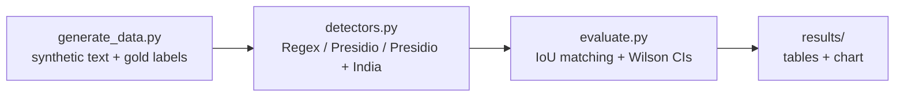
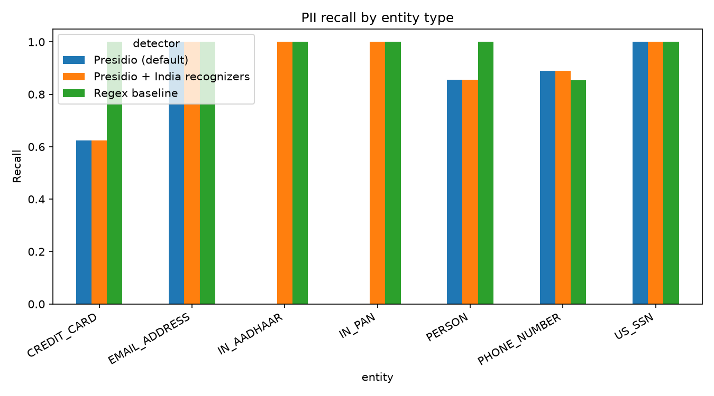

# Cross-Locale-PII-Detection-Benchmark
Benchmark of Microsoft Presidio vs regex on US and Indian PII formats, with 95% confidence intervals

# 🔍 Cross-Locale PII Detection Benchmark

**Presidio vs Regex on US and Indian data formats, with 95% confidence intervals**


Do widely used PII detectors work equally well on US and Indian data formats, and where do they fail? This project answers that with a reproducible benchmark: synthetic text with exact gold labels, three detectors, and precision and recall reported with Wilson 95% confidence intervals.

## At a glance

| 1,500 sentences | 7 entity types | 3 detectors | Evaluation |
|---|---|---|---|
| 600 US, 600 Indian, 300 PII-free | names, emails, phones, cards, SSN, Aadhaar, PAN | Regex, Presidio, Presidio + India recognizers | span IoU ≥ 0.5, Wilson 95% CIs |

## 🎯 Key findings

Results from seed 42 with `en_core_web_sm`. Small variations are expected with other library or model versions.

| # | Finding | Evidence |
|---|---|---|
| 1 | Default Presidio missed every Indian ID | 0 of 77 Aadhaar and 0 of 65 PAN detected. Adding `InAadhaarRecognizer` and `InPanRecognizer` raised recall to 100% for both. |
| 2 | Format alone cannot separate PAN from look-alike codes | PAN precision was 0.30 with the India recognizer: product codes (5 letters, 4 digits, 1 letter) in PII-free text were flagged. Context is needed. |
| 3 | Default Presidio missed Mastercard 2-series cards | Credit card recall 0.62. All 106 misses started with 2. Every number starting with 4 or 5 was found. |
| 4 | Name recall depends on locale | Presidio found 0.95 of US names but 0.76 of Indian names. |
| 5 | No detector was uniformly better across locales | Presidio phone recall: 0.80 US vs 1.00 IN. Regex phone recall: 1.00 US vs 0.68 IN. |
| 6 | Fixing recall can cost precision | False alarms on 300 PII-free sentences: regex 235, Presidio 24, Presidio + India recognizers 151 (118 were PAN look-alikes). |

## 🧭 How it works



**Detectors compared**

| Detector | Description |
|---|---|
| Regex baseline | Hand-written patterns for each entity type |
| Presidio (default) | [Microsoft Presidio](https://github.com/microsoft/presidio) analyzer with default recognizers and spaCy NER |
| Presidio + India recognizers | Default plus `InAadhaarRecognizer` and `InPanRecognizer` |

**Dataset** (all synthetic, no real personal information)

- Generated by `generate_data.py` with a fixed seed (42), so every run produces the same data.
- Seven entity types: `PERSON`, `EMAIL_ADDRESS`, `PHONE_NUMBER`, `CREDIT_CARD`, `US_SSN`, `IN_AADHAAR`, `IN_PAN`.
- Names and emails come from [Faker](https://faker.readthedocs.io/) (`en_US`, `en_IN`). Phone, Aadhaar (valid Verhoeff checksum) and PAN generators are custom, with several formats each (spaces, dashes, country codes).
- 300 hard-negative sentences contain PII-looking strings such as order IDs, product codes, ISBNs, IP addresses and tracking numbers.
- Every entity has gold character offsets.

**Method**

- A prediction is a true positive if the entity type matches and the span IoU with an unmatched gold span is at least 0.5. Unmatched predictions are false positives and unmatched gold spans are false negatives.
- Precision, recall and F1 are computed per entity type, with Wilson 95% confidence intervals.
- Recall is also split by locale (US vs IN), and false alarms are counted on PII-free sentences.

## 📊 Results

Precision / recall per entity type:

| Entity | Regex baseline | Presidio (default) | Presidio + India recognizers |
|---|---|---|---|
| `EMAIL_ADDRESS` | 1.00 / 1.00 | 1.00 / 1.00 | 1.00 / 1.00 |
| `PHONE_NUMBER` | 0.38 / 0.85 | 0.85 / 0.89 | 0.85 / 0.89 |
| `PERSON` | 1.00 / 1.00 | 0.96 / 0.86 | 0.96 / 0.86 |
| `CREDIT_CARD` | 0.83 / 1.00 | 0.99 / 0.62 | 0.99 / 0.62 |
| `US_SSN` | 1.00 / 1.00 | 1.00 / 1.00 | 1.00 / 1.00 |
| `IN_AADHAAR` | 0.50 / 1.00 | n/a / 0.00 | 0.90 / 1.00 |
| `IN_PAN` | 0.56 / 1.00 | n/a / 0.00 | 0.30 / 1.00 |

`n/a` means the detector produced no predictions of that type, so precision is undefined.



<details>
<summary><b>Recall by locale (US vs IN) with 95% CIs</b></summary>

| Detector | Entity | US recall (95% CI) | IN recall (95% CI) |
|---|---|---|---|
| Regex baseline | `PERSON` | 1.00 [0.98, 1.00] | 1.00 [0.98, 1.00] |
| Regex baseline | `PHONE_NUMBER` | 1.00 [0.97, 1.00] | 0.68 [0.59, 0.76] |
| Regex baseline | `CREDIT_CARD` | 1.00 [0.97, 1.00] | 1.00 [0.97, 1.00] |
| Presidio (default) | `PERSON` | 0.95 [0.91, 0.97] | 0.76 [0.70, 0.81] |
| Presidio (default) | `PHONE_NUMBER` | 0.80 [0.72, 0.85] | 1.00 [0.97, 1.00] |
| Presidio (default) | `CREDIT_CARD` | 0.61 [0.53, 0.69] | 0.64 [0.55, 0.71] |

</details>

<details>
<summary><b>False alarms on 300 PII-free sentences</b></summary>

| Detector | False alarms | PII-free sentences |
|---|---|---|
| Regex baseline | 235 | 300 |
| Presidio (default) | 24 | 300 |
| Presidio + India recognizers | 151 | 300 |

</details>

Full tables with confidence intervals are in `results/results.md` and the CSV files in `results/`.

## 🚀 Reproduce

Windows PowerShell:

```powershell
python -m venv venv
venv\Scripts\activate
python -m pip install -r requirements.txt
python -m spacy download en_core_web_sm
python generate_data.py
python evaluate.py
```

Linux or macOS: use `source venv/bin/activate` instead of the activate line.

For stronger name recognition, run `python -m spacy download en_core_web_lg` and then `python evaluate.py --model en_core_web_lg`.

## 🗂️ Project structure

```
generate_data.py   synthetic data and gold labels
detectors.py       regex baseline and Presidio wrappers
evaluate.py        scoring, confidence intervals, tables, chart
data/              generated dataset (jsonl)
results/           result tables and chart
```

## ⚠️ Limitations

- Data is synthetic and template-based, so absolute numbers are optimistic. For example, the regex `PERSON` result is inflated because every generated name is two capitalized words.
- English text only, seven entity types, no typos, OCR noise or obfuscated formats.
- Hard negatives were designed to resemble PII, so false alarm rates are stress-test numbers, not real-world rates.
- Results use the small spaCy model by default and depend on library versions.

## 🔭 Future work

- Add context-aware checks (for example, keywords near a PAN) and re-measure precision.
- Add noisy text and multi-seed runs.
- Add an LLM-based detector as another baseline.
- Evaluate on public annotated datasets.

## 🧰 Tech stack

Python, Microsoft Presidio, spaCy, Faker, pandas, matplotlib.

## 📄 License

MIT. See `LICENSE`.

## 👩‍💻 Author

**H. Jasmine Nisha**, B.E. Computer Science and Engineering (Cyber Security)
